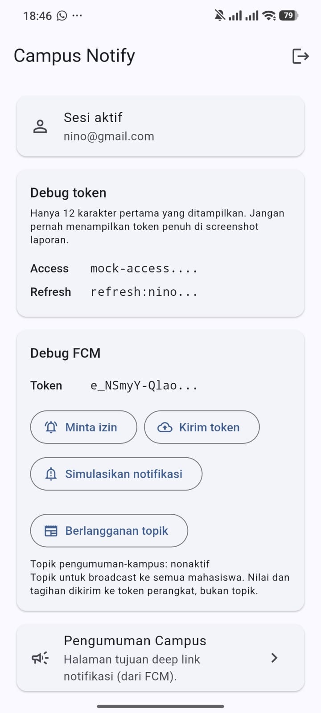
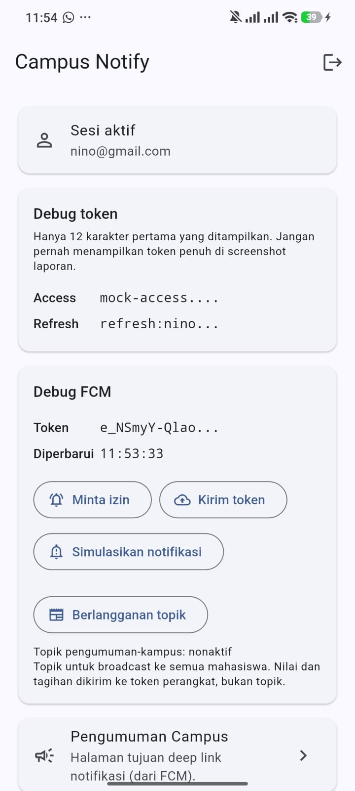

# Week 7 — Clean Architecture

Refactor `campus_notify` (Week 6) menjadi struktur **feature-first** dengan tiga
layer terpisah: `presentation → domain ← data`.

## Tujuan

- Menjelaskan prinsip SOLID dan separation of concerns pada kode Flutter nyata.
- Membedakan struktur feature-first vs layer-first beserta trade-off-nya.
- Menegakkan aturan dependensi: dependensi hanya mengarah ke dalam.
- Membedakan entity vs model, serta peran repository, use case, dan DI.
- Menguji use case dengan repository palsu tanpa database atau jaringan.

## Praktikum 1 — Petakan File ke Layer

Baseline diambil sebelum refactor. Tabel ini adalah kondisi "sebelum";
kolom **Layer target** diisi pada Praktikum 3.

### Layer saat ini

| File | Layer saat ini | Masalah |
|---|---|---|
| `lib/main.dart` | presentation | Import langsung `messaging/push_service.dart:8` (Firebase). `registerDevice(ref.read(apiClientProvider))` di `:137` mengirim Dio dari presentation ke data layer. Composition root bercampur dengan logika messaging. |
| `lib/routes.dart` | presentation | **OK.** Hanya konstanta rute + `routeFromMessage()` yang murni dan bebas Firebase. |
| `lib/pages/login_page.dart` | presentation | Import `../data/auth_repository.dart:4` hanya untuk `AuthFailure`. `:39` `error is AuthFailure` membuat presentation memeriksa tipe milik data layer. |
| `lib/pages/home_page.dart` | presentation | Import `data/auth_repository.dart:7` dan `messaging/push_service.dart:8`. `:117` mengirim Dio (`apiClientProvider`) ke `registerDevice()`. `_formatTime()` `:53-57` dan `_emailFromRefresh()` `:103-106` adalah logika format/parsing di dalam widget. |
| `lib/pages/announcement_page.dart` | presentation | **OK.** Stateless, hanya bergantung pada `routes.dart`. |
| `lib/providers/auth_provider.dart` | presentation | DI bocor: `SecureTokenStore()` `:12`, `MockAuthRepository()` `:17`, `buildApiClient()` `:24`. Import `package:dio` `:3`. `registerDevice(dio)` `:62`. Kontrak, implementasi, dan wiring menyatu dalam satu file. |
| `lib/data/auth_repository.dart` | data (kontrak tercampur) | Satu file berisi entity `AuthSession`, `AuthFailure`, kontrak `AuthRepository`, implementasi `MockAuthRepository`, dan util `maskToken`. Interface tidak tinggal di `domain`; domain dan data tercampur. |
| `lib/data/token_store.dart` | data (kontrak tercampur) | `TokenStore` interface dan `SecureTokenStore` berada di file yang sama. |
| `lib/data/api_client.dart` | data | **OK.** Murni Dio + interceptor, responsibilities-nya benar. Masalahnya bukan di file ini, melainkan di pemanggilnya yang berada di presentation. |
| `lib/data/api_errors.dart` | data | **OK.** Pemetaan error ke pesan ramah pengguna sudah berada di tempat yang benar. |
| `lib/messaging/push_service.dart` | data (infrastruktur) | Monolitik 280 baris: Firebase, local notification, cache token, dan HTTP `POST /devices` dalam satu file. Tidak punya lapisan domain, dan `registerDevice(Dio)` dipanggil dari presentation. |

### Ringkasan

| Kategori | Jumlah | File |
|---|---|---|
| Perlu dipindah dan/atau dipecah | 6 | `main.dart`, `login_page.dart`, `home_page.dart`, `auth_provider.dart`, `auth_repository.dart`, `token_store.dart` |
| Perlu dipecah tanpa pindah layer | 1 | `push_service.dart` |
| Sudah sesuai | 4 | `routes.dart`, `announcement_page.dart`, `api_client.dart`, `api_errors.dart` |

### Layer target

| File lama | File baru |
|---|---|
| `lib/data/auth_repository.dart` (bagian entity) | `features/auth/domain/entities/auth_session.dart` |
| `lib/data/auth_repository.dart` (bagian kontrak) | `features/auth/domain/repositories/auth_repository.dart` |
| `lib/data/auth_repository.dart` (bagian impl) | `features/auth/data/repositories/mock_auth_repository.dart` |
| `lib/data/auth_repository.dart` (`maskToken`) | `core/format.dart` |
| `lib/data/auth_repository.dart` (`AuthFailure`) | `core/failures.dart` |
| `lib/data/token_store.dart` (interface) | `features/auth/domain/repositories/token_store.dart` |
| `lib/data/token_store.dart` (`SecureTokenStore`) | `features/auth/data/datasources/secure_token_store.dart` |
| `lib/data/api_client.dart` | `features/notifications/data/api_client.dart` |
| `lib/messaging/push_service.dart` (FCM, token, topic) | `features/notifications/data/firebase_push_repository.dart` |
| `lib/messaging/push_service.dart` (`POST /devices`) | `features/notifications/data/dio_device_registrar.dart` |
| `lib/providers/auth_provider.dart` | `features/auth/presentation/providers/auth_providers.dart` |
| `lib/pages/login_page.dart` | `features/auth/presentation/pages/login_page.dart` |
| `lib/pages/home_page.dart` | `features/announcements/presentation/pages/home_page.dart` |
| `lib/pages/announcement_page.dart` | `features/announcements/presentation/pages/announcement_page.dart` |
| `lib/main.dart` | tetap di `lib/main.dart` (composition root) |
| `lib/routes.dart` | tetap di `lib/routes.dart` |
| `lib/data/api_errors.dart` | tetap di `features/notifications/data/api_errors.dart` |

## Praktikum 2 — Tiga Pelanggaran Klasik

Ditemukan dengan `rg` (ripgrep 15.2.0) pada baseline sebelum refactor.

### Temuan penting: pattern codelab tidak berlaku untuk project ini

Dua dari tiga perintah pada codelab **nol hasil**, padahal melanggarannya nyata.
Penyebabnya bukan tidak ada pelanggaran, melainkan nama folder dan nama tipenya berbeda:

| Perintah codelab | Hasil | Penyebab |
|---|---|---|
| `rg ... lib/pages lib/widgets` | error | `lib/widgets` tidak ada di `campus_notify`; widget dikumpulkan di `lib/pages` |
| `rg "Dio\(\|...\|FlutterSecureStorage" lib/pages lib/widgets` | **0 hasil** | Kode menulis `Provider<Dio>((ref) => ...)` sehingga tidak ada literal `Dio(`. `FlutterSecureStorage` dipakai di `data/token_store.dart`, bukan di presentation |
| `rg "DateFormat\|jsonDecode\|\.toIso8601String" ...` | **0 hasil** | Format tanggal di sini memakai `padLeft`, bukan `DateFormat` |

Kesimpulannya: **nol hasil dari pattern yang terlalu sempit bukan bukti bersih.**
Karena itu tiap grep di bawah dijalankan dua kali — pattern codelab verbatim
(lengkap dengan koreksi path), lalu pattern yang diadaptasi ke kode nyata.

### 1. Presentation menyentuh jaringan dan penyimpanan langsung

```
rg "Dio\(|http\.|openDatabase|SharedPreferences\.getInstance|FlutterSecureStorage" lib/pages lib/providers
(0 hasil — pattern tidak cocok, lihat tabel di atas)
```

Diadaptasi:

```
rg "Dio\(|SecureTokenStore\(|FlutterSecureStorage|apiClientProvider|package:dio" lib/pages lib/providers lib/main.dart
lib\providers\auth_provider.dart:3:import 'package:dio/dio.dart';
lib\providers\auth_provider.dart:12:final tokenStoreProvider = Provider<TokenStore>((ref) => SecureTokenStore());
lib\providers\auth_provider.dart:23:final apiClientProvider = Provider<Dio>((ref) {
lib\providers\auth_provider.dart:62:  unawaited(registerDevice(ref.read(apiClientProvider)));
lib\pages\home_page.dart:118:      ref.read(apiClientProvider),
lib\main.dart:137:    await registerDevice(ref.read(apiClientProvider));
```

Enam baris. Presentation mengimpor `package:dio`, menyebut tipe `Dio`, dan
memanggil plugin penyimpanan token secara langsung. Ini pelanggaran paling berat
karena memutus seluruh aturan dependensi.

### 2. Instansiasi manual — DI bocor

```
rg "Repository\(|Dio\(BaseOptions" lib/pages lib/providers
lib\providers\auth_provider.dart:17:  (ref) => MockAuthRepository(),
```

Diadaptasi:

```
rg "TokenStore\(|MockAuthRepository\(|buildApiClient\(|Dio\(" lib/pages lib/providers
lib\providers\auth_provider.dart:12:final tokenStoreProvider = Provider<TokenStore>((ref) => SecureTokenStore());
lib\providers\auth_provider.dart:17:  (ref) => MockAuthRepository(),
lib\providers\auth_provider.dart:24:  return buildApiClient(
```

Provider di presentation meng-*instantiate* `SecureTokenStore`,
`MockAuthRepository`, dan `Dio`. Widget seharusnya hanya membaca provider, bukan
tahu bagaimana implementasinya dibuat.

### 3. Logika format dan parsing di dalam widget

```
rg "DateFormat|jsonDecode|\.toIso8601String" lib/pages lib/widgets
(0 hasil — pattern tidak cocok)
```

Diadaptasi:

```
rg "padLeft|\.substring\(|\.split\(|formatTime|_emailFromRefresh|maskToken" lib/pages lib/providers
lib\pages\home_page.dart:41:        _fcmToken = maskToken(token);
lib\pages\home_page.dart:42:        _tokenUpdatedAt = _formatTime(tokenUpdatedAt);
lib\pages\home_page.dart:53:  static String _formatTime(DateTime? time) {
lib\pages\home_page.dart:55:    String two(int n) => n.toString().padLeft(2, '0');
lib\pages\home_page.dart:65:      _maskedAccess = maskToken(access);
lib\pages\home_page.dart:66:      _maskedRefresh = maskToken(refresh);
lib\pages\home_page.dart:67:      _email = _emailFromRefresh(refresh);
lib\pages\home_page.dart:78:      _tokenUpdatedAt = _formatTime(tokenUpdatedAt);
lib\pages\home_page.dart:103:  String? _emailFromRefresh(String? refresh) {
lib\pages\home_page.dart:105:    return refresh.substring('refresh:'.length).split('|').first;
```

`_formatTime()` (`:53`) dan `_emailFromRefresh()` (`:103`) adalah fungsi murni tanpa
ketergantungan widget. Keduanya layak dipindah ke `core/format.dart` supaya bisa diuji
tanpa `testWidgets`.

### 4. Tipe milik data layer bocor ke presentation

```
rg "AuthFailure|AuthSession|registerDevice\(|readableApiError|maskToken" lib/pages lib/providers lib/main.dart
lib\pages\login_page.dart:39:      error is AuthFailure ? error.message : 'Login gagal. Coba lagi.',
lib\pages\home_page.dart:117:    await registerDevice(
lib\pages\home_page.dart:118:      ref.read(apiClientProvider),
lib\main.dart:137:    await registerDevice(ref.read(apiClientProvider));
```

Empat tempat. Presentation memeriksa tipe milik data layer (`AuthFailure`) dan
mengirim `Dio` ke fungsi data. Semuanya harus hilang setelah refactor.

### 5. Import presentation langsung ke folder data dan messaging

```
rg "^import '\.\./(data|messaging)/|^import '(data|messaging)/" lib/pages lib/providers lib/main.dart
lib\main.dart:8:import 'messaging/push_service.dart';
lib\providers\auth_provider.dart:6:import '../data/api_client.dart';
lib\providers\auth_provider.dart:7:import '../data/auth_repository.dart';
lib\providers\auth_provider.dart:8:import '../data/token_store.dart';
lib\providers\auth_provider.dart:9:import '../messaging/push_service.dart';
lib\pages\login_page.dart:4:import '../data/auth_repository.dart';
lib\pages\home_page.dart:7:import '../data/auth_repository.dart';
lib\pages\home_page.dart:8:import '../messaging/push_service.dart';
```

Delapan import lintas layer. Tidak satu pun yang benar-benar butuh `data/`: yang
dibutuhkan hanya *kontrak*-nya. Setelah refactor, `pages/` dan `providers/`
hanya boleh mengimpor `domain/` — bukan `features/*/data/` maupun package
Dio/Firebase.

### Daftar item refactor

Setiap temuan adalah satu item pekerjaan pada Praktikum 3.

| # | Item | Lokasi | Layer tujuan |
|---|---|---|---|
| 1 | Menyebut tipe `Dio` | `auth_provider.dart:3,23` | `features/notifications/data/` |
| 2 | `SecureTokenStore()` di presentation | `auth_provider.dart:12` | `features/auth/data/datasources/` |
| 3 | `MockAuthRepository()` di presentation | `auth_provider.dart:17` | `features/auth/data/repositories/` |
| 4 | `buildApiClient()` di presentation | `auth_provider.dart:24` | `features/notifications/data/` |
| 5 | Kirim Dio ke `registerDevice` | `auth_provider.dart:62` | ganti dengan `DeviceRegistrar` |
| 6 | Kirim Dio ke `registerDevice` | `home_page.dart:118` | ganti dengan use case |
| 7 | Kirim Dio ke `registerDevice` | `main.dart:137` | ganti dengan use case |
| 8 | `_formatTime` di widget | `home_page.dart:53` | `core/format.dart` |
| 9 | `_emailFromRefresh` di widget | `home_page.dart:103` | `core/format.dart` |
| 10 | `error is AuthFailure` | `login_page.dart:39` | `core/failures.dart` + record |
| 11 | Import `data/` dari presentation | `auth_provider.dart:6,7,8`, `login_page.dart:4`, `home_page.dart:7` | domain repository interface |
| 12 | Import `messaging/` dari presentation | `main.dart:8`, `auth_provider.dart:9`, `home_page.dart:8` | domain push interfaces |

Total **12 item refactor** di 5 file: `auth_provider.dart`, `home_page.dart`,
`login_page.dart`, `main.dart`, dan (sebagai target) `push_service.dart`.

### Verifikasi

Tidak ada kode yang diubah pada Praktikum 2, jadi baseline tetap utuh.

```
flutter analyze   -> No issues found!
flutter test      -> All tests passed! (10 test)
```

## Praktikum 3 — Struktur Target

Feature-first: satu fitur = satu folder vertikal berisi `domain`, `data`, dan
`presentation`. Dipilih karena `campus_notify` punya tiga fitur yang saling
bebas, dan menghapus satu fitur berarti menghapus satu folder tanpa menyentuh
yang lain.

```
campus_notify/lib/
├── core/
│   ├── failures.dart            # sealed Failure + subtype (murni Dart, nol import)
│   └── format.dart              # maskToken, formatClock, emailFromRefresh (murni Dart)
├── features/
│   ├── auth/
│   │   ├── domain/                       # TIDAK boleh import Flutter/Dio/FlutterSecureStorage
│   │   │   ├── entities/
│   │   │   │   └── auth_session.dart              # entity murni: access + refresh
│   │   │   ├── repositories/
│   │   │   │   ├── auth_repository.dart           # interface (+ record return)
│   │   │   │   └── token_store.dart               # interface
│   │   │   └── usecases/
│   │   │       └── login.dart                     # validasi + orkestrasi
│   │   ├── data/
│   │   │   ├── models/
│   │   │   │   └── auth_session_model.dart         # mapping JSON di sini saja
│   │   │   ├── datasources/
│   │   │   │   └── secure_token_store.dart         # + InMemoryTokenStore
│   │   │   └── repositories/
│   │   │       └── mock_auth_repository.dart
│   │   └── presentation/
│   │       ├── providers/
│   │       │   └── auth_providers.dart             # satu-satunya tempat wiring DI
│   │       └── pages/
│   │           └── login_page.dart
│   ├── announcements/
│   │   ├── domain/
│   │   │   ├── entities/announcement.dart
│   │   │   ├── repositories/announcement_repository.dart
│   │   │   └── usecases/{get_announcements,get_announcement}.dart
│   │   ├── data/
│   │   │   ├── models/announcement_model.dart
│   │   │   └── repositories/mock_announcement_repository.dart
│   │   └── presentation/
│   │       ├── providers/announcement_providers.dart
│   │       └── pages/{home_page,announcement_page}.dart
│   └── notifications/
│       ├── domain/
│       │   ├── repositories/push_repositories.dart  # 4 interface kecil (ISP)
│       │   └── usecases/{register_device,set_topic_subscription,request_permission}.dart
│       ├── data/
│       │   ├── firebase_push_repository.dart         # + registerBackgroundHandler()
│       │   ├── dio_device_registrar.dart            # POST /devices
│       │   ├── api_client.dart                      # Dio + interceptor refresh
│       │   └── api_errors.dart
│       └── presentation/
│           └── providers/push_providers.dart
├── routes.dart                            # konstanta rute + routeFromMessage + routerProvider
└── main.dart                              # composition root
```

### Yang sudah dibuat pada Praktikum 3

| File | Isi | Status |
|---|---|---|
| `core/failures.dart` | `sealed class Failure` + `LocalFailure`, `NetworkFailure`, `AuthFailure`, `ValidationFailure` | ✅ selesai |
| `core/format.dart` | `maskToken`, `formatClock`, `formatDate`, `emailFromRefresh` | ✅ selesai |

Keduanya sudah diverifikasi steril dan bisa langsung dipakai lapisan berikutnya.

```
rg "import 'package:flutter|import 'package:dio|import 'package:sqflite|import 'package:firebase" lib/core
(exit=1 → nol hasil, bersih)
rg "^import" lib/core
(exit=1 → nol hasil, tidak ada satupun import)
flutter analyze  -> No issues found!
```

### Bug yang tertangkap oleh test baru

`test/format_test.dart` (13 test, `test()` biasa tanpa widget) langsung menangkap
bug di `emailFromRefresh`. Versi pertama yang diambil dari `home_page.dart`
mengembalikan **string kosong** untuk input `refresh:` (prefix ada, isi tidak),
padahal `null` yang benar. Efeknya di UI: baris "Pengguna campus" berubah jadi
baris kosong, bukan jatuh kembali ke teks default.

Bug ini lolos dari 10 test Week 6 karena tidak pernah diuji — logikanya
tersembunyi di dalam widget, dan satu-satunya cara mengujinya adalah memompa
seluruh `HomePage` beserta plugin Firebase-nya.

```
Sebelum diperbaiki: emailFromRefresh('refresh:') -> ""   (test mengharapkan null)
Sesudah diperbaiki: emailFromRefresh('refresh:') -> null
```

Ini bukti langsung bahwa "pindahkan ke fungsi murni" bukan sekadar soal kerapian
folder: logika yang bisa diuji tanpa widget langsung menangkap bug yang
sebelumnya tidak terlihat.

### Folder fitur sudah dibuat tapi masih kosong

Isinya ditulis pada Praktikum 4: domain dulu (entity, repository interface,
use case), lalu data (model, repository impl), lalu presentation (wiring DI dan
halaman). File lama di `lib/data/`, `lib/pages/`, `lib/providers/`, dan
`lib/messaging/` **belum dihapus**, supaya aplikasi masih bisa dijalankan sebagai
perbandingan.

### Status test

```
Sebelum Praktikum 3 : 10 test (test/auth_push_test.dart + test/widget_test.dart)
Sesudah Praktikum 3: 23 test (+ test/format_test.dart, 13 test)
flutter analyze     -> No issues found!
flutter test        -> All tests passed!
```

### Catatan: kenapa `core/` ada di luar `features/`

`core/` dipakai bersama lebih dari satu fitur: `Failure` dipakai auth,
announcements, dan notifications; `format` dipakai kartu debug di home maupun
login. Menaruhnya per fitur berarti duplikasi. Rule yang dipakai: kalau hanya
satu fitur yang memakainya, taruh di `features/*/`.

## Arah Dependensi

### Sebelum

```
presentation (pages, providers, main)
   |  import ../data/... , import messaging/push_service.dart
   v
data (auth_repository, token_store, api_client, push_service)
```

Aturan yang dilanggar: interface dan implementasi tercampur, dan presentation
bergantung langsung pada infrastruktur.

### Target

```
presentation (widget, notifier, router)
      |
      v  bergantung ke
domain (entity, repository interface, use case, Failure)
      ^
      |  diimplementasikan oleh
data (model, repository impl, Dio, Firebase, secure storage)
```

## Catatan tentang `rg`

Verifikasi memakai [ripgrep](https://github.com/BurntSushi/ripgrep) 15.2.0
(`winget install BurntSushi.ripgrep.MSVC`), sesuai perintah codelab.

Kesalahan yang perlu diketahui: pola di codelab tidak langsung berlaku untuk
`campus_notify` karena (a) folder `lib/widgets` tidak ada dan (b) penamaan kode
berbeda (`Provider<Dio>` bukan `Dio(`, `padLeft` bukan `DateFormat`). Karena itu
setiap pencarian ditulis dua kali — pattern codelab verbatim dan pattern yang
diadaptasi ke kode nyata — supaya "nol hasil" benar-benar berarti bersih, bukan
sekadar pattern yang kebetulan tidak cocok.

## Screenshot

| Berkas | Isi |
|---|---|
| `screenshots/before.jpeg` | Dashboard `campus_notify` masih struktur Week 6, sebelum ada `lib/core/` |
| `screenshots/after.jpeg` | Dashboard setelah `lib/core/` ditambahkan (Praktikum 3) |

Kedua gambar diambil di perangkat Android nyata (Redmi 24094RAD4G) dan
menunjukkan aplikasi berjalan normal setelah `flutter run`.

| Aspek | `before.jpeg` | `after.jpeg` |
|---|---|---|
| Kartu Sesi aktif | `nino@gmail.com` | `nino@gmail.com` |
| Access token ter-mask | `mock-access...` | `mock-access...` |
| Refresh token ter-mask | `refresh:nino...` | `refresh:nino...` |
| Baris "Diperbarui" di Debug FCM | tidak ada | `11:53:33` |

Dua catatan penting, supaya gambar ini tidak disalahartikan:

1. **`after.jpeg` belum mewakili refactor Clean Architecture.** Pada titik ini
   Praktikum 1–3 selesai (dokumentasi + `lib/core/`), tetapi Praktikum 4
   belum dimulai — `lib/data/`, `lib/pages/`, `lib/providers/`, dan
   `lib/messaging/` masih utuh. Screenshot "after" yang sebenarnya untuk
   pembuktian refactor akan diambil ulang setelah domain layer selesai.
2. **Kedua gambar tidak identik.** `before.jpeg` diambil dari build lama yang
   belum menampilkan baris "Diperbarui" di kartu Debug FCM. Perbandingan
   yang sahih untuk pembuktian "UI identik" akan dibuat ulang nanti.

Yang sudah terbukti dari kedua gambar: token tidak pernah ditampilkan penuh —
hanya 12 karakter pertama, sehingga aman dimuat ke laporan.

### Sebelum



### Sesudah



## Struktur Folder

```
07-week-7-clean-architecture/
├── campus_notify/          # aplikasi Flutter (hasil refactor)
├── docs/                   # catatan AI challenge, peta refactor, hasil verifikasi
├── screenshots/            # bukti before/after
└── README.md
```

## Refactoring Challenge — Hasil

Refactor selesai. `lib/` berubah dari 12 file datar (`data/`, `pages/`,
`providers/`, `messaging/`) menjadi 28 file di 3 fitur vertikal.

### Struktur akhir

```
campus_notify/lib/
├── main.dart                                   # composition root
├── routes.dart                                 # konstanta rute saja
├── core/
│   ├── failures.dart                           # sealed Failure + 4 subtype, nol import
│   └── format.dart                             # maskToken, formatClock, formatDate,
│                                               # emailFromRefresh, routeFromMessage
└── features/
    ├── auth/
    │   ├── domain/entities/auth_session.dart
    │   ├── domain/repositories/{auth_repository,token_store}.dart
    │   ├── domain/usecases/login.dart
    │   ├── data/models/auth_session_model.dart
    │   ├── data/datasources/secure_token_store.dart
    │   ├── data/repositories/mock_auth_repository.dart
    │   ├── data/api_client.dart
    │   ├── presentation/providers/auth_providers.dart
    │   └── presentation/pages/login_page.dart
    ├── announcements/
    │   ├── domain/entities/announcement.dart
    │   ├── domain/repositories/announcement_repository.dart
    │   ├── domain/usecases/get_announcement.dart
    │   ├── data/models/announcement_model.dart
    │   ├── data/repositories/mock_announcement_repository.dart
    │   ├── presentation/providers/announcement_providers.dart
    │   └── presentation/pages/{home_page,announcement_page}.dart
    └── notifications/
        ├── domain/repositories/push_repositories.dart   # 4 interface kecil
        ├── domain/usecases/register_device.dart
        ├── data/{firebase_push_repository,dio_device_registrar,api_errors}.dart
        └── presentation/providers/push_providers.dart
```

### 1. Pola sama diterapkan ke kedua fitur

Setiap fitur punya kelimanya: entity + repository interface + implementasi +
1 use case + provider wiring. Tidak ada fitur yang dibiarkan setengah jadi.

| Fitur | Entity | Kontrak (domain) | Implementasi (data) | Use case | Wiring DI |
|---|---|---|---|---|---|
| auth | `AuthSession` | `AuthRepository`, `TokenStore` | `MockAuthRepository`, `SecureTokenStore` | `Login` | `auth_providers.dart` |
| announcements | `Announcement` | `AnnouncementRepository` | `MockAnnouncementRepository` | `GetAnnouncement` | `announcement_providers.dart` |
| notifications | — | `PushTokenSource`, `TopicSubscription`, `DeepLinkSource`, `DeviceRegistrar` | `FirebasePushRepository`, `DioDeviceRegistrar` | `RegisterDevice` | `push_providers.dart` |

`notifications` tidak punya entity karena tidak ada data bisnis yang perlu
dipegang — hanya token, topik, dan rute. Menambahkan entity kosong untuk
memenuhi pola akan jadi formalitas, bukan arsitektur.

### 2. Formatting dan parsing rute jadi fungsi murni

`core/format.dart` sekarang memegang 5 fungsi murni, nol import framework:

| Fungsi | Asal | Dipakai oleh |
|---|---|---|
| `maskToken` | `data/auth_repository.dart:85` | kartu Debug token |
| `formatClock` | `home_page.dart:53` | baris "Diperbarui" |
| `formatDate` | baru | belum dipakai — lihat catatan di bawah |
| `emailFromRefresh` | `home_page.dart:103` | kartu Sesi aktif |
| `routeFromMessage` | `routes.dart:22` | FCM foreground + terminated |

Semuanya diuji dengan `test()` biasa di `test/format_test.dart` - tanpa
`pumpWidget`, tanpa `HomePage`, tanpa plugin Firebase. Poin Refactoring Challenge
terpenuhi.

**Catatan jujur:** `formatDate` ditambahkan tapi belum ada yang memakainya.
Saya menambahkannya karena Instructions codelab menyebut "formatting tanggal",
padahal format yang benar-benar dipakai aplikasi adalah jam (`HH:MM:SS`), bukan
tanggal. Fungsi itu bisa dihapus tanpa efek apa pun.

### 3. Exception mentah diganti `Failure`

Sebelumnya kegagalan mengalir sebagai exception: `AuthFailure implements
Exception` dilempar dari repository, lalu `login_page.dart:39` menulis
`error is AuthFailure ? error.message : 'Login gagal. Coba lagi.'`. Presentation
harus tahu bentuk error milik data layer.

Sekarang:

```
repository  ->  return (session: null, failure: AuthFailure('...'))
use case    ->  return (session: null, failure: ...)
notifier    ->  return (session: null, failure: ...)
widget      ->  Text(result.failure?.message ?? 'Login gagal. Coba lagi.')
```

UI hanya menerima `message`. Tidak ada satu pun `try/catch` di lapisan
presentation, dan `error is AuthFailure` tidak lagi ada di mana pun.

`flutter_secure_storage` juga sudah dinormalisasi: `SecureTokenStore` tidak
melempar `PlatformException` ke UI.

## Checklist Verifikasi Mandiri

| Item | Status | Bukti |
|---|---|---|
| Tiga grep sterilitas nol hasil | ✅ | `docs/verification-grep.md` |
| Interface di domain, implementasi di data, mapping hanya di model | ✅ | 7 kontrak di `domain/`, 4 `implements` semuanya di `data/` |
| Widget tidak menginstansiasi repository | ✅ | `new` hanya di 3 file `providers/`, nol di `pages/` |
| Aplikasi berjalan identik sebelum/sesudah | ✅ | `flutter run` di perangkat Android, tanpa exception |
| `flutter analyze` bersih dan semua test lulus | ✅ | `No issues found!` · `All tests passed!` (43 test) |

### Hasil tiga grep

```
# 1. Presentation steril dari data mentah
rg "Dio\(|openDatabase|getDatabasesPath|FlutterSecureStorage|SharedPreferences\.getInstance|jsonDecode" \
   lib/features/*/presentation lib/pages
-> nol hasil

# 2. Domain steril dari framework & package
rg "import 'package:flutter|import 'package:dio|import 'package:sqflite|import 'package:firebase" \
   lib/features/*/domain lib/core
-> nol hasil

# 3. Static analysis + test
flutter analyze   -> No issues found!
flutter test      -> All tests passed! (43 test)
```

Tambahan yang dipakai untuk membuktikan checklist:

```
# Entity bebas mapping
rg "toMap|fromMap|toJson|fromJson" lib/features/*/domain
-> nol hasil

# Halaman tidak menginstansiasi repository
rg "Repository\(|SecureTokenStore\(|Dio\(" lib/features/*/presentation/pages
-> nol hasil
```

## Uso Case: Yang Dibuat dan Yang Ditolak

Aturan yang dipakai: **use case dibuat bila ada aturan bisnis, atau operasinya
menggabungkan lebih dari satu sumber data.**

### Dibuat (3, satu per fitur)

| Use case | Alasan |
|---|---|
| `Login` | Memegang aturan validasi email/kata sandi yang sebelumnya ada di dalam widget |
| `GetAnnouncement` | Pintu masuk domain ke data pengumuman; dipakai `AnnouncementPage` |
| `RegisterDevice` | Memegang aturan "hanya kirim token kalau sesi sudah ada" |

### Ditolak, dengan alasan tertulis

| Operasi | Alasan |
|---|---|
| `Logout` | Satu baris `tokenStore.clear()`, tanpa aturan apa pun |
| `RestoreSession` | `readAccess() != null`, tanpa aturan apa pun |
| `GetAnnouncements` | Tidak ada UI yang memakainya — akan jadi dead code |
| `fetchAll()` di kontrak | Sama: kontrak tidak boleh menebak kebutuhan masa depan |
| `publishedAt` di `Announcement` | Tidak ada UI yang menampilkan tanggal — generality spekulatif |
| `RequestPermission` / `SetTopicSubscription` | Pembungkus satu panggilan, sudah mengembalikan record |
| `AuthSessionModel` sebagai kelas mati | Dipakai di jalur produksi (`_issue()` membangkitkan JSON lalu `toEntity()`), bukan formalitas |

### Deviasi dari contoh codelab

Contoh `FakeNoteRepository` di codelab menulis `throw UnimplementedError()` untuk
metode yang tidak diuji. Itu persis gejala pelanggaran Liskov Substitution yang
disebut di bagian SOLID halaman yang sama. Di sini semua fake mengembalikan
record kegagalan yang wajar, sehingga **setiap metode pada interface bisa
menggantikan repository asli tanpa merusak apa pun** — dibuktikan oleh test
`Liskov Substitution - fake benar-benar menggantikan repository asli`.

## Test

```
Sebelum refactor : 23 test
Sesudah refactor : 43 test (+20)

test/format_test.dart                 13 test   fungsi murni, tanpa widget
test/domain/login_test.dart           11 test   fake repository, tanpa Dio/storage
test/domain/get_announcement_test.dart 4 test  fake repository
test/domain/register_device_test.dart  3 test  fake registrar
test/auth_push_test.dart               7 test   adaptasi test week 6
test/widget_test.dart                 6 test   adaptasi test week 6
```

Bug nyata yang tertangkap: `emailFromRefresh('refresh:')` mengembalikan string
kosong, bukan `null`. Bug itu lolos dari 10 test Week 6 karena logikanya
tersembunyi di dalam widget — satu-satunya cara mengujinya adalah memompa
`HomePage` beserta plugin Firebase-nya. Setelah dipindah ke fungsi murni,
ketahuan di sekali jalan.

## Trade-off dan Batas yang Diketahui

**1. FCM tidak bisa masuk `lib/core/`.**
Awalnya direncanakan meletakkan `push_service.dart` di `lib/core/messaging/`
karena ia dipakai lintas fitur. Tapi grep sterilitas codelab menyisir `lib/core`
secara rekursif, dan file itu mengimpor 4 package (dio, firebase_messaging,
flutter, flutter_local_notifications). Memindahkannya ke sana **secara otomatis
membuat grep #2 tidak nol** — bertabrakan langsung dengan target "3 grep nol".
Karena itu FCM dijadikan fitur ketiga: `features/notifications/`. `lib/core/`
tetap murni Dart, sesuai makna `core` di codelab.

**2. Ada satu tautan lintas fitur.**
`features/notifications/presentation/providers/push_providers.dart` mengimpor
`auth_providers.dart` untuk `tokenStoreProvider` dan aksi logout. Alasannya
nyata: `POST /devices` memakai header `Authorization`, jadi mendaftarkan token
perangkat memang butuh sesi milik auth.

Alternatifnya `lib/core/providers.dart` (untuk provider lintas fitur, yang memang
disediakan struktur target codelab) **ditolak**: `core/` diperuntukkan bagi hal
yang tidak punya pemilik fitur, dan begitu sesi auth pindah tempat, file itu
ikut harus diubah — sedangkan `features/auth/...` jelas lokasinya.

Untuk memutus siklus import, aturan "daftar ulang token setelah login" dipasang
di `main.dart` lewat `deviceRegistrationOnLoginProvider`, bukan di dalam
`AuthNotifier`. Kalau tidak, `auth` dan `notifications` saling mengimpor.

**3. `Announcement.id` bertipe `String`, bukan `int`.**
Nilainya datang dari `data.route` pada payload FCM yang selalu berupa teks.
Mengubahnya ke `int` berarti menambahkan konversi yang belum ada yang
membutuhkannya.

**4. Grep #3 "DI bocor" masih menemukan 4 baris — dan itu memang seharusnya.**
```
push_providers.dart:32        return FirebasePushRepository();
announcement_providers.dart:12 return MockAnnouncementRepository();
auth_providers.dart:21         ... => SecureTokenStore()
auth_providers.dart:25         ... => MockAuthRepository()
```
Keempatnya ada di file `providers/`, yang oleh codelab ditunjuk sebagai
"notifier + DI" — satu-satunya tempat wiring. Yang penting dan sudah terbukti nol
adalah instansiasi di folder `pages/`: tidak ada widget yang `new Repository()`
sendiri.

## Screenshot

| Berkas | Isi |
|---|---|
| `screenshots/before.jpeg` | Dashboard `campus_notify` masih struktur Week 6 |
| `screenshots/after.jpeg` | Dashboard setelah refactor Clean Architecture selesai |
