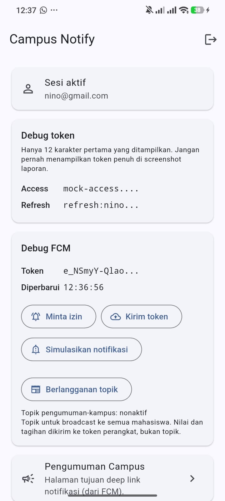

# Week 8: Mid Project Review dan Code Review

Minggu ini bukan menambah fitur. Yang dikerjakan adalah disiplin kolaborasi pada
project `campus_notify` hasil refactor Week 7: memperbaiki cara bercabang,
menulis commit, membuka Pull Request, melewati review, dan menolak PR kotor
secara otomatis.

Hasil akhirnya satu bug nyata diperbaiki lewat review, satu blocker ditemukan
dan dicatat, dan tiga pemeriksaan mesin berjalan otomatis di setiap PR.

## Tujuan

- Menjelaskan Git Flow dan perbedaan peran `main`, `develop`, `feature/*`, dan
  `fix/*`.
- Menulis commit dan Pull Request yang mudah direview.
- Melakukan peer review dengan checklist, bukan dengan kesan.
- Menjalankan `flutter analyze`, `dart format`, dan `flutter test` sampai bersih.
- Menilai kesiapan project paruh semester dan menindaklanjuti hasil review.
- Memverifikasi saran review dari AI sebelum diterapkan.

## Status Paruh Semester

Checklist dari codelab, dengan bukti.

| Butir | Status | Bukti |
|---|---|---|
| Struktur feature-first terbukti | Selesai | Tiga grep sterilitas nol hasil, lihat `docs/verification-grep.md` di Week 7 |
| `flutter analyze` bersih | Selesai | `No issues found!` |
| Test hijau | Selesai | 48 test lulus |
| PR kecil dengan commit jelas | Selesai | 4 PR merged, semuanya di bawah 300 baris |
| README, screenshot, cara menjalankan | Selesai | Dokumen ini |
| Komentar review ditindaklanjuti | Selesai | PR #2, dua putaran review sampai approve |

Dua hal yang perlu dinyatakan terbuka:

1. **`main` belum pernah rilis.** `main` masih di `865ad79`, tertinggal 15 commit
   dari `develop`. Ini sesuai model branching codelab: `main` hanya berubah lewat
   release, dan paruh semester belum sampai tahap itu.
2. **`screenshots/` di folder ini kosong.** UI tidak berubah sejak akhir Week 7,
   jadi gambar dirujuk dari sana daripada menduplikasi file yang sama. Lihat
   bagian Screenshot.

## Peta Issue dan PR

### Pull Request

| PR | Judul | Ukuran | Status |
|---|---|---|---|
| #2 | `fix(auth): segarkan kartu debug setelah sesi berganti` | +290 / -9 | Merged |
| #3 | `docs(review): catat temuan review dan keputusan week 8` | +191 / -0 | Merged |
| #4 | `ci: jalankan analyze dan test pada setiap pull request` | +36 / -0 | Merged |
| #6 | `docs(review): catat praktikum 2 dan 3 pada review checklist` | +96 / -0 | Merged |

PR #2 punya 5 commit karena melewati dua putaran review. Putaran pertama
menemukan dua hal, putaran kedua menemukan empat hal lagi. Semua ditindaklanjuti
sebelum merge.

### Issue

| Issue | Judul | Label | Status |
|---|---|---|---|
| #1 | Kartu Debug token menampilkan sesi lama setelah login ulang | bug | Closed, ditutup PR #2 |
| #5 | Bungkus TokenStore dengan provider revisi | enhancement | Open, sengaja ditunda |
| #7 | `AnnouncementModel.fromJson` gagal untuk id bertipe String | bug | Open, belum diperbaiki |

## Fitur Utama

Aplikasi tidak berubah sejak Week 7. Fitur yang ada:

| Fitur | Lokasi |
|---|---|
| Login dan guard route | `features/auth/presentation/`, `main.dart` |
| Penyimpanan token aman | `features/auth/data/datasources/secure_token_store.dart` |
| Refresh token otomatis saat 401 | `features/auth/data/api_client.dart` |
| Validasi kredensial di domain | `features/auth/domain/usecases/login.dart` |
| Kartu Debug token dengan masking | `features/auth/presentation/providers/auth_providers.dart` |
| Pengumuman dari seed JSON | `features/announcements/` |
| Deep link notifikasi ke halaman pengumuman | `core/format.dart`, `routes.dart` |
| FCM: token, izin, topik, tiga app state | `features/notifications/` |

## Stack Teknologi

| Teknologi | Versi | Peran |
|---|---|---|
| Flutter | 3.47.5 | Framework |
| Dart | 3.13.4 | Bahasa |
| flutter_riverpod | ^3.4.3 | State management dan DI |
| go_router | ^18.0.2 | Routing, guard, deep link |
| dio | ^5.11.1 | HTTP client dan interceptor |
| flutter_secure_storage | ^11.2.0 | Penyimpanan token |
| firebase_core | ^4.15.0 | Inisialisasi Firebase |
| firebase_messaging | ^16.7.0 | Push notification |
| flutter_local_notifications | ^22.3.1 | Banner notifikasi foreground |
| flutter_lints | ^6.0.0 | Analisis statis |
| ripgrep | 15.2.0 | Alat verifikasi, bukan dependency aplikasi |

## Cara Menjalankan

```bash
cd 07-week-7-clean-architecture/campus_notify
flutter pub get

# Salin google-services.json ke android/app/ (tidak di-commit)
flutter run
```

Butuh perangkat Android nyata atau emulator dengan Google Play Services. Akun
demo: email berformat email, kata sandi minimal 6 karakter.

Pemeriksaan yang sama dengan CI:

```bash
dart format --output=none --set-exit-if-changed lib test
flutter analyze
flutter test
```

Verifikasi arsitektur Week 7:

```bash
rg "Dio\(|openDatabase|getDatabasesPath|FlutterSecureStorage|SharedPreferences\.getInstance|jsonDecode" \
   lib/features/*/presentation
rg "import 'package:flutter|import 'package:dio|import 'package:sqflite|import 'package:firebase" \
   lib/features/*/domain lib/core
```

Ketiga pemeriksaan mesin di atas juga dijalankan otomatis oleh
`.github/workflows/ci.yml` pada setiap PR dan setiap push ke `develop`.

## Hasil yang Dicapai

### Angka

| | Sebelum Week 8 | Sesudah |
|---|---|---|
| Commit tidak konvensional | 19 dari 23 | 0 dari 10 |
| Branch kerja | hanya `main` | `develop` + 4 branch, semuanya lewat PR |
| Commit langsung ke `main` | 23 | 0 |
| CI | tidak ada | format, analyze, test |
| Test | 43 | 48 |
| File belum diformat | 27 | 0 |
| PR di bawah 300 baris | tidak ada PR | 4 dari 4 |

### Bukti mesin

```
flutter analyze -> No issues found!
flutter test    -> All tests passed! (48 test)
dart format     -> Formatted 36 files (0 changed)
CI              -> format + analyze + test, success
```

### Bug yang diperbaiki lewat review

`sessionDebugProvider` membaca secure storage, tetapi tidak pernah dihitung
ulang. Akibatnya setelah logout lalu login dengan akun lain, kartu Debug token
menampilkan token sesi sebelumnya. Setelah logout pun token yang sudah dihapus
masih tampil.

Perbaikan menyentuh tiga jalur penulis secure storage:

| Jalur | Lokasi |
|---|---|
| Login berhasil | `auth_providers.dart` |
| Logout | `auth_providers.dart` |
| Token diperbarui interceptor 401 | `api_client.dart` lewat `onSessionRenewed` |

Jalur ketiga baru ditemukan saat review, dan itu jalur yang paling mudah
terlewat karena berjalan tanpa interaksi pengguna.

## Alur Kerja

### Branching

```
main      865ad79   dilindungi, hanya berubah lewat release
develop   fa9a1be   default branch, target semua PR
```

Setiap pekerjaan bercabang dari `develop`:

| Branch | PR |
|---|---|
| `fix/session-debug-stale` | #2 |
| `docs/week-8-review` | #3 |
| `chore/ci-pipeline` | #4 |
| `docs/praktikum-3` | #6 |

Semuanya dihapus setelah merge, lokal dan remote.

### Format commit

Format yang dipakai: `tipe(scope): deskripsi singkat`. Tipe yang muncul minggu
ini: `fix`, `test`, `docs`, `ci`, `chore`, `style`.

Sepuluh commit non-merge minggu ini semuanya mengikuti format itu. Verifikasi:

```bash
git log --format="%s" 865ad79..develop | grep -v "^Merge "
```

### Satu penyimpangan yang dicatat

Dua commit dokumentasi masuk langsung ke `develop` tanpa PR: `dbbf638` dan
`44a5e48`. Alasannya dicatat di `docs/review-checklist.md` bagian "Penyimpangan
yang disengaja". Aturan "`develop` tidak disentuh langsung" tetap berlaku untuk
perubahan kode.

## Struktur Folder

```
08-week-8-mid-project-review/
├── docs/
│   ├── ai-review-vs-keputusan.md   lima temuan AI, bukti, keputusan
│   └── review-checklist.md         audit riwayat, branch, perbaikan commit
├── screenshots/                    kosong, lihat bagian Screenshot
└── README.md
```

### Isi dokumen

`docs/review-checklist.md` memuat tiga praktikum:

1. Audit riwayat: 7 temuan, 5 di antaranya blocker
2. Branch kerja: pembuatan `develop` dan tiga branch PR
3. Perbaikan pesan commit: tabel sebelum dan sesudah untuk tiga pesan terburuk

`docs/ai-review-vs-keputusan.md` memuat AI Prompt Challenge:

- prompt verbatim
- 5 temuan dengan level dan potongan kode perbaikan
- tabel usulan AI versus keputusan final
- 4 usulan yang ditolak dengan alasan tertulis
- checklist verifikasi 6 butir dengan bukti

## Screenshot

UI tidak berubah sejak akhir Week 7, jadi gambar dirujuk dari sana:

| Berkas | Isi |
|---|---|
| `../07-week-7-clean-architecture/screenshots/after-refactor.jpeg` | Dashboard setelah refactor Clean Architecture |
| `../07-week-7-clean-architecture/screenshots/before.jpeg` | Kondisi lama sebagai pembanding |

Yang dibuktikan: disiplin Week 8 tidak mengubah tampilan aplikasi sama sekali.
Pekerjaannya ada di riwayat git, branch, dan pipeline, bukan di layar.



## Utang Teknis dan Batasan

### Issue yang sengaja ditunda

**#7, `AnnouncementModel.fromJson` gagal untuk id bertipe String.**
Ini blocker, bukan saran. `fromJson` memakai `as num?`, dan cast itu melempar
`TypeError` kalau nilainya `String`. Seed repository memakai id bertipe `String`,
jadi kartu "Pengumuman Campus" membuka halaman yang menampilkan error, bukan
judul dan isi pengumuman.

Reproduksi:

```
type 'String' is not a subtype of type 'num?' in type cast
announcement_model.dart 16:23  new AnnouncementModel.fromJson
mock_announcement_repository.dart 37:39  MockAnnouncementRepository.fetchById
```

Bug ini tidak tertangkap test karena `widget_test.dart` memeriksa
`find.text('Pengumuman #3')`, yaitu judul `AppBar` yang dirender di semua state
termasuk `error`.

Alasan penundaan: ditemukan pada akhir minggu, dan perbaikannya menyentuh
`data` sehingga perlu test sendiri.

**#5, `invalidate` tersebar di tiga titik.** Penulis keempat ke secure storage
harus ingat menambahkan `ref.invalidate`. Usulan perbaikannya provider revisi
atau dekorator `TokenStore`.

### Utang arsitektur

Empat import `presentation` ke `presentation` masih ada:

| File | Import |
|---|---|
| `push_providers.dart` | `auth_providers.dart` |
| `home_page.dart` | `auth_providers.dart` |
| `home_page.dart` | `push_providers.dart` |

Tiga import lain yang masih wajar adalah `domain` ke `domain` dan `data` ke
`domain`, karena `POST /devices` memang butuh sesi auth. Rinciannya di
`docs/ai-review-vs-keputusan.md` temuan 2.

### Batasan

- Backend masih mock. `POST /devices` dan endpoint auth belum ada.
- Uji manual 5 menit per fitur belum seluruhnya dijalankan. Yang sudah
  dilakukan: `flutter run` di perangkat Android dan 48 test otomatis.
- CI hanya memeriksa kode. Bug perilaku seperti #7 tetap lolos karena test yang
  ada tidak menjangkau jalur tersebut.

## Refleksi

### Apa beda LGTM buta dengan approve yang bertanggung jawab?

LGTM buta berhenti di "kodenya terlihat wajar". Approve yang bertanggung jawab
berarti reviewer sudah checkout, menjalankan, dan menguji sendiri, lalu bisa
menjelaskan alasan setiap temuan.

Kasus minggu ini menunjukkan bedanya. Reviewer AI menyatakan test sudah memadai.
Reviewer manusia mempertanyakan satu hal: test menulis ke store langsung, bukan
lewat `login()`. Setelah dibuktikan dengan menghapus baris `ref.invalidate` di
`login()`, test lama tetap hijau. Artinya jalur itu memang tidak teruji.

Kalau saya menerima LGTM dari AI saja, bug yang sama akan tetap ada meski semua
test hijau. Itu risiko paling nyata dari review yang tidak dijalankan.

### Kapan komentar wajib request changes, dan kapan cukup saran?

Batas yang saya pakai: **request changes kalau ada perilaku yang salah, atau
kalau test memberi rasa aman yang palsu.** Sisanya saran.

Yang masuk request changes minggu ini:

| Temuan | Alasan |
|---|---|
| Interceptor 401 tidak memberi tahu kartu debug | Pengguna melihat data basi |
| Test tidak menguji jalur `login()` | Test hijau padahal jalur itu tidak terkunci |
| Body PR basi | Reviewer berikutnya salah kira cakupan |
| Komentar berubah di luar perbaikan | Diff jadi menyesatkan |

Yang cukup saran: penamaan, panjang baris, dan usulan provider revisi. Yang
terakhir memang perbaikan arsitektur, tetapi tidak memperbaiki sesuatu yang
sedang salah, jadi tidak perlu menahan merge.

### Bagian mana dari review AI yang ditolak atau disederhanakan?

Empat usulan ditolak, dan dua di antaranya paling penting:

**Pindahkan `api_errors.dart` ke `lib/core/`.** Terdengar wajar karena fungsinya
seperti util umum. Ditolak karena file itu mengimpor `package:dio`, sementara
grep sterilitas Week 7 mensyaratkan `lib/core` bebas framework. Memindahkannya
akan merusak aturan yang baru saja ditegakkan minggu lalu.

**Ganti record dengan `fpdart` `Either<Failure, T>`.** Ditolak karena record
bawaan Dart sudah cukup, dan menambah dependency untuk mengganti tipe bawaan
tidak mengubah perilaku. Kalau nanti butuh `map` dan `fold` berantai, baru
dipertimbangkan.

Yang saya terima justru temuan yang tidak saya duga: interceptor 401 ternyata
jalur penulis token ketiga yang tidak pernah memberi tahu pembaca lain.

### Satu hal konkret yang diperbaiki setelah review sejawat?

Test untuk `sessionDebugProvider` diubah supaya menempuh `AuthNotifier.login()`,
bukan menulis ke store langsung.

Dampaknya langsung terlihat. Sebelum perbaikan, menghapus `ref.invalidate` di
`login()` tidak membuat test gagal. Sesudah perbaikan, test gagal dengan:

```
Expected: 'lain@polinema.ac.id'
  Actual: 'mhs@polinema.ac.id'
  tanpa invalidate di login(), nilai cache sesi pertama bertahan
```

Ditambah satu test yang menempuh alur persis seperti laporan bug: login A,
logout, login B. Ketiga test itu sekarang mengunci perilaku yang sebelumnya
hanya dijaga oleh keberuntungan.
