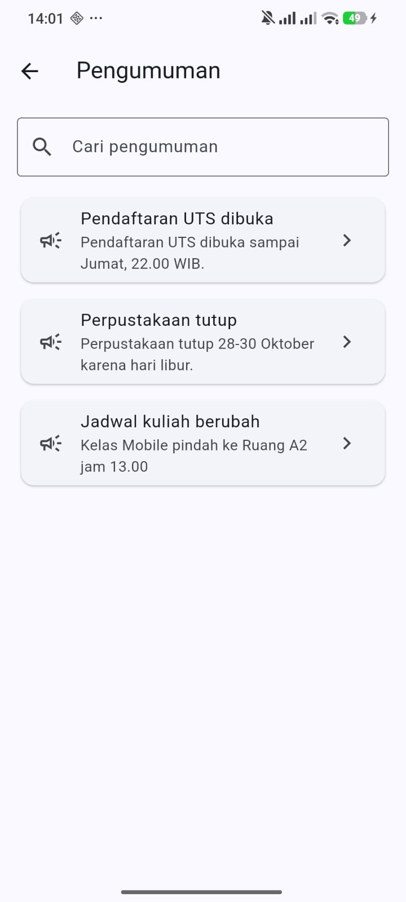
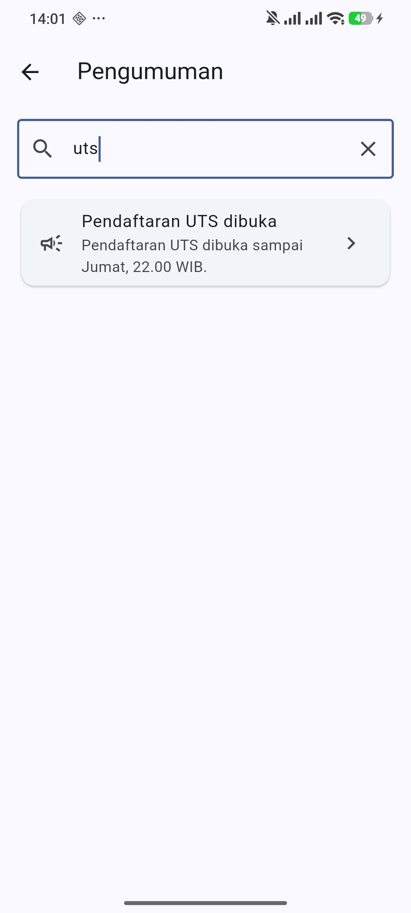
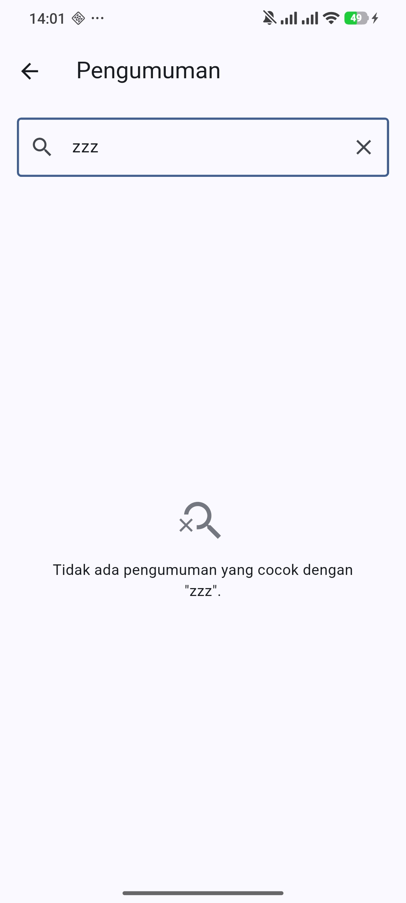
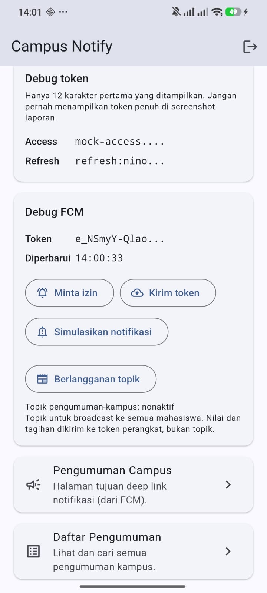

# Week 9: AI-Assisted Development

Menambahkan satu fitur kecil ke `campus_notify` dengan bantuan AI, lalu
memverifikasi, menguji, dan merefactor hasilnya. Fitur yang dipilih:
**pencarian pengumuman** dengan empty state.

Fokus minggu ini bukan fiturnya, melainkan prosesnya: bagaimana membedakan kode
AI yang benar dari yang terlihat benar.

## Tujuan

- Menjelaskan siklus prompt, generate, verify, test, refactor, explain.
- Menulis prompt dan konteks yang efektif untuk fitur Flutter kecil.
- Mengenali halusinasi dan keterbatasan AI pada kode Flutter.
- Merefactor kode hasil AI ke Clean Architecture.
- Menguji hasil AI dengan `flutter analyze` dan test.
- Mendokumentasikan prompt, keputusan, dan bukti di `docs/ai-log.md`.

## Fitur

| Aspek | Isi |
|---|---|
| Nama | Pencarian pengumuman |
| Masukan | Kata kunci di kolom cari |
| Keluaran | Daftar pengumuman yang cocok |
| Cakupan pencarian | Judul **dan** isi |
| Aturan | Abaikan huruf besar/kecil, buang spasi tepi, query kosong berarti semua |
| Empty state | Dua: "belum ada pengumuman" dan "tidak ada yang cocok" |

Rute baru: `/daftar-pengumuman`. Kartu menu baru di dashboard dengan kunci
`home-announcement-list`.

### Kenapa judul dan isi, bukan judul saja

Codelab mencontohkan "search judul notes". Untuk pengumuman kampus, judul saja
tidak cukup. Pengguna mencari "A2" untuk menemukan pengumuman yang menyebut
ruang kelas, dan kata itu ada di isi, bukan di judul. Kalau pencarian hanya
menyentuh judul, query seperti itu menghasilkan nol.

## Struktur

```
features/announcements/
├── domain/
│   ├── repositories/announcement_repository.dart   + fetchAll()
│   └── usecases/search_announcements.dart          filter murni + use case
├── data/
│   ├── models/announcement_model.dart              bug fromJson diperbaiki
│   └── repositories/mock_announcement_repository.dart  + fetchAll()
└── presentation/
    ├── providers/announcement_providers.dart       query + hasil
    └── pages/announcement_list_page.dart           daftar, cari, empty state
```

Filter berada di domain sebagai fungsi statis:

```dart
static List<Announcement> filter(List<Announcement> items, String query)
```

Konsekuensinya bisa diuji dengan `test()` biasa, tanpa `pumpWidget`. Sepuluh
test di `search_announcements_test.dart` semuanya `test()`, bukan `testWidgets`.

## Prompt yang dipakai

Formula 5 slot dari codelab:

```
Peran: senior Flutter dev
Konteks: feature-first (presentation -> domain <- data), Riverpod 3,
  Dio, tanpa SQLite. Project campus_notify hasil refactor Week 7.
Tugas: tambah fitur pencarian pengumuman dengan dua empty state.
Batas: jangan ubah arsitektur. Filter harus di domain, bukan di widget.
  Jangan panggil repository dari build(). Maksimal 2 file baru di lib/.
Output: kode + test untuk filter murni + test widget empty state.
```

Konteks yang ditempel: kontrak repository, entity, pola provider yang sudah ada,
dan versi package dari `pubspec.yaml`. Yang **tidak** ditempel: API key, token,
dan seluruh isi repo.

Prompt lengkap dan alasannya ada di `docs/ai-log.md`.

## Stack Teknologi

| Teknologi | Versi | Peran |
|---|---|---|
| Flutter | 3.47.5 | Framework |
| Dart | 3.13.4 | Bahasa |
| flutter_riverpod | ^3.4.3 | State management dan DI |
| go_router | ^18.0.2 | Routing |
| dio | ^5.11.1 | HTTP client |
| flutter_secure_storage | ^11.2.0 | Penyimpanan token |
| firebase_core / firebase_messaging | ^4.15.0 / ^16.7.0 | Push notification |
| flutter_local_notifications | ^22.3.1 | Banner notifikasi |
| flutter_lints | ^6.0.0 | Analisis statis |
| ripgrep | 15.2.0 | Alat verifikasi, bukan dependency |

## Cara Menjalankan

```bash
cd 09-week-9-ai-assisted-development/campus_notify
flutter pub get

# Salin google-services.json ke android/app/ (tidak di-commit)
flutter run
```

Lalu:

1. Login dengan akun demo.
2. Buka kartu **Daftar Pengumuman** di dashboard.
3. Ketik kata kunci, misalnya `uts` atau `A2`.
4. Untuk melihat empty state, ketik kata yang tidak ada, misalnya `zzz`.

Pemeriksaan mesin:

```bash
dart format --output=none --set-exit-if-changed lib test
flutter analyze
flutter test
```

Verifikasi arsitektur:

```bash
rg "Dio\(|openDatabase|getDatabasesPath|FlutterSecureStorage|SharedPreferences\.getInstance|jsonDecode" \
   lib/features/*/presentation
rg "import 'package:flutter|import 'package:dio|import 'package:sqflite|import 'package:firebase" \
   lib/features/*/domain lib/core
rg "toMap|fromMap|toJson|fromJson" lib/features/*/domain
```

## Hasil yang Dicapai

```
flutter analyze -> No issues found!
flutter test    -> All tests passed! (71 test)
dart format     -> Formatted 41 files (0 changed)
```

| | Week 7 | Week 9 |
|---|---|---|
| Test | 48 | 71 |
| File di `lib/` | 28 | 30 |
| Grep presentation bocor | nol | nol |
| Grep domain steril | nol | nol |

23 test baru:

| Berkas | Jumlah | Isi |
|---|---|---|
| `test/domain/search_announcements_test.dart` | 10 | Filter murni dan use case |
| `test/data/announcement_model_test.dart` | 7 | `fromJson` untuk id String, int, hilang |
| `test/presentation/announcement_list_test.dart` | 6 | Empty state dan penyaringan |

### Bug nyata yang ditemukan lewat test

`AnnouncementModel.fromJson` memakai `as num?` untuk field `id`. Cast itu
melempar `TypeError` untuk nilai `String`, padahal seed repository memakai id
`String`. Artinya seluruh pembacaan pengumuman gagal, termasuk `fetchById` yang
sudah ada sejak Week 7.

Bug ini tidak pernah tertangkap karena tidak ada test yang memanggil `fromJson`
langsung, dan `widget_test.dart` memeriksa judul `AppBar` yang dirender di semua
state termasuk error.

Bukti sebelum perbaikan:

```
type 'String' is not a subtype of type 'num?' in type cast
  announcement_model.dart 16:23  new AnnouncementModel.fromJson
```

Perbaikannya satu baris: `json['id']?.toString() ?? ''`. Tujuh test baru
mengunci perilakunya.

### Halusinasi dan kesalahan yang tercatat

| # | Temuan | Jenis | Cara membuktikan |
|---|---|---|---|
| 1 | Fake repository lama tidak punya `fetchAll` setelah kontrak berubah | Kesalahan kompilasi | `flutter analyze` menunjuk `get_announcement_test.dart:13` |
| 2 | `fromJson` gagal untuk id `String` | Bug nyata | `flutter test` melempar `TypeError` |
| 3 | Asersi test saya sendiri terlalu longgar (`textContaining` menemukan 2 widget) | Kesalahan test | `flutter test` melaporkan "Found 2 widgets" |
| 4 | `build()` versi pertama 72 baris | Pelanggaran batas 40 baris | Dihitung langsung, lalu dipecah |

Temuan 3 dan 4 bukan bug aplikasi, melainkan kesalahan pada pekerjaan saya
sendiri. Dicatat terpisah supaya tidak tercampur.

### Refactor yang dilakukan

`build()` halaman daftar versi pertama 72 baris. Setelah dipecah:

| Bagian | Baris |
|---|---|
| `build()` halaman | 23 |
| `_SearchField` | 40 |
| `_ResultBody` | 41 |
| `_AnnouncementTile` | 19 |
| `_Message` | 23 |

71 test tetap lulus setelah pemecahan, termasuk enam test widget yang menyentuh
langsung kunci `search-field`, `search-clear`, dan `search-empty`.

## Saran AI yang ditolak

| Saran | Alasan penolakan |
|---|---|
| Filter di dalam `build()` | Satu-satunya cara menguji jadi `testWidgets` yang memompa seluruh halaman |
| Menyaring di repository (`fetchAll(query)`) | Repository jadi tahu aturan bisnis, dan aturannya bercabang dua tempat kalau sumbernya berubah jadi SQL |
| `StateProvider` untuk kata kunci | Dihapus di Riverpod 3, memakai `NotifierProvider` |
| Menyimpan hasil filter di state notifier | `FutureProvider` turunan sudah cukup. Dua sumber kebenaran bisa tidak sinkron |
| Menambah `fetchAll` tanpa use case | Presentation jadi terikat ke kontrak repository |

Alasan lengkap dan buktinya di `docs/ai-log.md` bagian 6.

## Utang dan Batasan

- **Belum diuji manual untuk kasus gagal.** Yang sudah dijalankan: daftar penuh,
  query cocok, dan query tidak cocok. Belum diuji di perangkat untuk keadaan
  repository gagal dan daftar benar-benar kosong; keduanya baru diuji lewat test
  widget.
- **Tidak ada debounce.** Setiap ketikan memicu `fetchAll()`. Aman untuk tiga
  pengumuman di memori. Untuk data dari jaringan, setiap huruf akan memicu satu
  request, dan debounce 300 ms wajib ditambahkan.
- **Filter berjalan di memori** setelah mengambil seluruh daftar. Wajar untuk
  puluhan pengumuman, tidak wajar untuk ribuan.
- **`fetchAll` mengembalikan entity, bukan model.** Konversi terjadi di
  repository lewat `toEntity()`, sesuai aturan Week 7.

## Struktur Folder

```
09-week-9-ai-assisted-development/
├── campus_notify/          salinan Week 7 + fitur pencarian
├── docs/
│   └── ai-log.md           prompt, output, verifikasi, keputusan
├── screenshots/            dashboard, daftar, hasil, empty state
└── README.md
```

## Screenshot

Diambil di perangkat Android 

| Berkas | Isi |
|---|---|
| `screenshots/search-dashboard.jpeg` | Kartu **Daftar Pengumuman** di dashboard |
| `screenshots/search-list.jpeg` | Daftar penuh, kolom cari masih kosong |
| `screenshots/search-result.jpeg` | Query `uts` menghasilkan satu pengumuman |
| `screenshots/search-empty.jpeg` | Query `zzz` memunculkan empty state |

### Daftar penuh



Ketiga pengumuman tampil, urutan sesuai seed. Query kosong berarti tampilkan
semua, sesuai aturan di `SearchAnnouncements.filter`.

### Pencarian cocok



Query `uts` menyisakan satu pengumuman. Perhatikan: kata `uts` muncul di judul
**dan** isi, jadi test tidak bisa membedakan keduanya dari kasus ini. Yang
membedakan adalah screenshot berikutnya.

### Pencarian tidak cocok



Query `zzz` memunculkan pesan `Tidak ada pengumuman yang cocok dengan "zzz".`
Ini empty state yang berbeda dari "Belum ada pengumuman.", dan keduanya diuji
terpisah di `test/presentation/announcement_list_test.dart`.

### Dashboard



Kartu baru muncul di bawah "Pengumuman Campus", dengan kunci
`home-announcement-list`.

### Catatan: pencarian yang membedakan judul dan isi

Screenshot di atas belum membuktikan pencarian menyentuh **isi**, karena `uts`
ada di judul dan isi sekaligus. Bukti untuk itu ada di test, bukan di gambar:

```dart
test('mencocokkan isi, bukan hanya judul', () {
  // "A2" hanya ada di body pengumuman #3.
  final hasil = SearchAnnouncements.filter(_seed, 'A2');
  expect(hasil, hasLength(1));
  expect(hasil.first.id, '3');
});
```

Kalau mau dibuktikan lewat aplikasi, ketik `A2` di perangkat. Yang muncul hanya
"Jadwal kuliah berubah", karena kata itu tidak ada di judulnya.

## Refleksi

### Satu halusinasi AI apa yang ditemukan dan bagaimana membuktikannya?

Bukan halusinasi API, melainkan bug logika yang terlihat benar: `as num?` untuk
field `id`. Kodenya terbaca wajar, karena id memang berupa angka di banyak API.
Tapi seed repository memakai `String`, dan `as num?` adalah cast yang melempar,
bukan pemeriksaan yang mengembalikan `null`.

Cara membuktikannya bukan dengan membaca ulang kode, melainkan dengan menulis
test yang memanggil `fromJson` langsung:

```dart
final model = AnnouncementModel.fromJson({'id': '3', 'title': 'x', 'body': 'y'});
```

Test itu tidak gagal dengan asersi, melainkan melempar:

```
type 'String' is not a subtype of type 'num?' in type cast
```

Bedanya penting. Kalau test gagal karena asersi, artinya kode jalan tapi hasilnya
salah. Kalau test gagal karena exception, artinya kode tidak jalan sama sekali.
Yang kedua lebih parah, dan lebih mudah terlewat kalau tidak ada test yang
menyentuh jalur itu.

### Prompt mana yang paling membantu, dan apa yang diubah?

Yang paling membantu adalah satu kalimat batas: **"filter harus di domain, bukan
di widget"**.

Tanpa kalimat itu, bentuk paling wajar dari fitur pencarian adalah menaruh
`items.where(...)` di dalam `build()`. Itu bekerja, tampilannya sama, dan tidak
akan ditolak `flutter analyze`. Yang hilang adalah kemampuan mengujinya: satu-
satunya cara jadi memompa seluruh halaman.

Yang saya ubah dari prompt pertama: menambahkan **"jangan panggil repository dari
build()"**. Itu batas kedua yang ternyata perlu, karena `ref.read(...)` di dalam
`build()` juga lolos analyzer.

### Satu refactor apa yang dilakukan pada kode AI?

`build()` di `announcement_list_page.dart` mencapai 72 baris: kolom pencarian,
empat cabang state, dan pembentukan daftar dalam satu metode.

Dipecah menjadi `_SearchField`, `_ResultBody`, `_AnnouncementTile`, dan
`_Message`. `build()` halaman turun jadi 23 baris, dan tiap bagian punya satu
tanggung jawab.

Yang membuat refactor ini aman: enam test widget sudah menyentuh kunci
`search-field`, `search-clear`, dan `search-empty` sebelum pemecahan. Jadi
perubahan struktur bisa diverifikasi tanpa membuka aplikasi.

### Keputusan terima atau tolak mana yang paling sulit?

Menolak usulan menyaring di repository, yaitu `fetchAll(query)`.

Alasannya terasa masuk akal: kalau penyaringan dilakukan di sumber data, data
yang diambil lebih sedikit, dan untuk basis data itu memang lebih efisien.
Menolaknya terasa seperti mengorbankan performa demi kemurnian arsitektur.

Yang membuat saya tetap menolak: **aturan pencarian akan bercabang dua tempat.**
Sekarang filter ada di memori. Kalau nanti sumbernya SQL, aturan "abaikan huruf
besar/kecil dan cocokkan judul atau isi" harus ditulis ulang sebagai query, dan
dua implementasi itu akan berbeda diam-diam. Bug seperti itu sulit dilihat karena
keduanya terlihat benar.

Jalan tengahnya yang saya pilih: filter tetap di domain sebagai fungsi murni,
dan repository hanya menyediakan `fetchAll()`. Kalau nanti data terlalu besar,
yang berubah adalah **cara mengambil**, bukan **aturan menyaring**.
