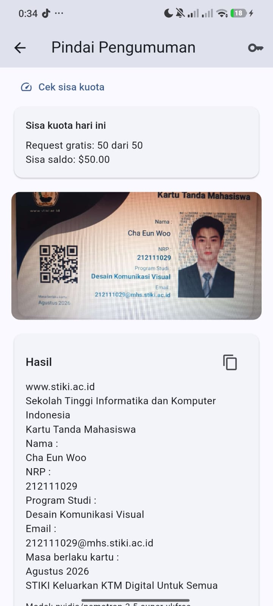
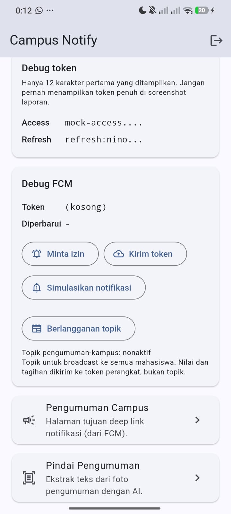

# Week 10: Integrasi Fitur AI

Menambahkan satu fitur AI ke `campus_notify` hasil Week 7: **Pindai Pengumuman**,
yaitu mengekstrak teks dari foto papan pengumuman kampus memakai model vision
lewat OpenRouter.

Bukan chat, bukan speech-to-text. OCR dipilih karena paling langsung menyambung
dengan fitur pengumuman yang sudah ada, dan tidak memerlukan izin mikrofon.

## Tujuan

- Memahami cara memanggil LLM API dari aplikasi mobile.
- Merancang fitur AI yang tidak melanggar dependency rule Week 7.
- Menerapkan prompt design yang aman dan sempit.
- Menangani privasi, biaya, error, dan fallback.
- Memverifikasi saran AI sebelum diterapkan.

## Fitur

| Aspek | Isi |
|---|---|
| Nama fitur | Pindai Pengumuman |
| Masukan | Foto dari kamera atau galeri, dikompres ke maksimal 1280 px dan kualitas 60 |
| Keluaran | Teks hasil ekstraksi, bisa disalin |
| Provider | OpenRouter, `POST /api/v1/chat/completions` |
| Model default | `google/gemma-4-31b-it:free`, dengan dua model cadangan gratis |
| Streaming | Tidak, satu jawaban utuh dengan indikator loading |

Rute baru: `/pindai`. Kartu menu baru di dashboard dengan kunci `home-scan`.

## Kenapa Pindai Pengumuman, bukan Pindai Dokumen

Codelab melarang mengirim NIK, nomor telepon, alamat, dan data sensitif ke AI
API. KTM berisi nama dan NIM, dan keduanya data pribadi. Mengunggah KTM ke pihak
ketiga bertentangan dengan aturan itu.

Karena itu fitur dibingkai sempit: hanya dokumen publik. Peringatan tertulis di
halaman: "Jangan memindai KTM, rapor, atau dokumen pribadi: gambar dikirim ke
penyedia AI di luar aplikasi."

## Arsitektur

Mengikuti pola Week 7, bukan contoh `lib/ai/ai_service.dart` di codelab yang
mencampur HTTP client, secure storage, dan `throw Exception` dalam satu kelas.

```
features/ocr/
├── domain/
│   ├── entities/ocr_result.dart
│   ├── repositories/ocr_repository.dart      kontrak, Uint8List, record return
│   ├── repositories/api_key_store.dart       kontrak key
│   └── usecases/extract_text.dart            validasi sebelum kirim
├── data/
│   ├── datasources/secure_api_key_store.dart
│   └── repositories/openrouter_ocr_repository.dart
└── presentation/
    ├── providers/ocr_providers.dart
    └── pages/scan_page.dart
```

Arah dependensi tetap `presentation -> domain <- data`.

Tiga keputusan yang menjaga aturan itu:

1. **Kontrak menerima `Uint8List`, bukan `XFile` atau `File`.** `XFile` berasal
   dari `image_picker` dan `File` dari `dart:io`. Kalau salah satunya masuk
   kontrak, `domain` ikut bergantung pada Flutter. `Uint8List` berasal dari
   `dart:typed_data`, jadi aman.
2. **`Dio` dibuat di `data/` lewat `buildOcrRepository()`.** Presentation hanya
   menerima kontrak `OcrRepository`. Ini sempat salah pada versi pertama: `Dio(`
   muncul di `ocr_providers.dart` dan langsung tertangkap grep sterilitas.
3. **Kegagalan lewat `Failure`, bukan `throw`.** Codelab memakai
   `throw Exception`, itu pola yang sudah ditinggalkan di Week 7.

## Prompt Design

### System prompt

```
Kamu alat OCR. Ekstrak semua teks yang terlihat pada gambar, apa adanya, tanpa
menambah penjelasan, tanpa markdown, tanpa komentar. Pertahankan urutan baris.
Jika tidak ada teks terbaca, balas dengan teks kosong. Jangan pernah menebak isi
yang tidak terlihat.
```

### User prompt

```
Ekstrak seluruh teks pada gambar ini.
```

### Empat komponen yang diminta codelab

| Komponen | Isi |
|---|---|
| System prompt | Persona "alat OCR" dan enam batasan di atas |
| User prompt | Satu baris, tanpa instruksi berulang |
| Konteks | Gambar itu sendiri, dikirim sebagai data URI base64 |
| Batas | "Jangan pernah menebak isi yang tidak terlihat", dan peringatan privasi di UI |

Rincian dan alasan tiap batasan ada di `docs/ai-log.md`.

## Keamanan dan Biaya

| Risiko | Mitigasi | Bukti |
|---|---|---|
| API key bocor di repo | Key tidak ada di kode. Pengguna memasukkannya lewat dialog pengaturan, disimpan di `flutter_secure_storage`. `.gitignore` ditambah `.env`, `.env.*`, `*.key` | `git check-ignore` menunjuk aturan itu |
| Key bocor di log | Key dikirim lewat header, bukan query string. Pesan error disusun dari status dan tipe, bukan dari `DioException.toString()` | Test `pesan error tidak pernah memuat API key` |
| Data pribadi terkirim | Fitur dibingkai sebagai pindai pengumuman. Tidak ada email, token, atau FCM token yang masuk prompt | Isi payload diperiksa test |
| Biaya melonjak | Model `:free`, gambar dikompres ke 1280 px kualitas 60, dan hanya satu gambar per aksi | `image_picker` dipanggil dengan `maxWidth` dan `imageQuality` |
| Kiriman terlalu besar | Ditolak sebelum dikirim kalau di atas 4 MB | Test `gambar di atas 4 MB ditolak` |
| API error | `AiFailure` dengan pesan asli penyedia, bukan exception | Test 401, 429, 503, JSON rusak |
| Kuota model gratis habis | Diklaim hanya kalau `X-RateLimit-Remaining` bernilai `0`; ada tombol cek kuota | Test `X-RateLimit-Remaining 0 berarti kuota harian habis` |
| Provider sedang penuh | `Retry-After` ditampilkan sebagai hitung mundur, bukan disebut kuota | Test `Retry-After berarti kapasitas provider, bukan kuota` |
| Model pertama rate-limited | Payload memakai `models` array berisi tiga model gratis, OpenRouter pindah otomatis | Test `payload memakai models array` |
| Tidak ada teks terbaca | Pesan menyarankan foto lebih dekat dan lebih terang | Test `jawaban kosong memberi saran memotret ulang` |

## Fallback

Fallback yang disediakan, dari yang paling ringan:

1. **Pesan jelas, bukan error mentah.** Setiap status HTTP punya pesan sendiri.
2. **Gambar tetap tampil.** Hasil lama tidak hilang saat pindai berikutnya gagal.
3. **Bisa ganti model.** `ocrModelProvider` bisa diubah tanpa mengubah kode, untuk
   saat model gratis sedang tidak tersedia.
4. **Bisa hapus key.** Tombol Hapus di dialog pengaturan.

Yang **tidak** disediakan: mode offline. OCR membutuhkan model di cloud, dan
membuat fallback ke OCR lokal berarti menambah dependency baru yang tidak
diminta codelab. Batasan ini dicatat, bukan disembunyikan.

## Perubahan dari Codelab

Codelab memberi contoh yang tidak semuanya cocok dengan project ini.

| Codelab | Yang dipakai | Alasan |
|---|---|---|
| `http: ^1.2.0` | `dio: ^5.11.1` yang sudah ada | Menambah `http` berarti dua HTTP client di satu aplikasi |
| `flutter_secure_storage: ^9.0.0` | `^11.2.0` yang sudah ada | Menurunkan versi berisiko merusak kode yang berjalan |
| `riverpod: ^2.5.0` | `flutter_riverpod: ^3.4.3` | Riverpod 3 menghapus `StateProvider`, jadi model memakai `NotifierProvider` |
| `lib/ai/ai_service.dart` | `features/ocr/{domain,data,presentation}` | Contoh codelab melanggar dependency rule Week 7 |
| `throw Exception` | record `(result, failure)` | Konsisten dengan `Failure` di Week 7 |
| Gemini `?key=` di query | `Authorization: Bearer` di header | Query string tercatat di log server dan proxy |

## Cara Menjalankan

```bash
cd 10-week-10-ai-feature-integration/campus_notify
flutter pub get

# Salin google-services.json ke android/app/ (tidak di-commit)
flutter run
```

Lalu:

1. Login dengan akun demo.
2. Buka kartu **Pindai Pengumuman** di dashboard.
3. Tekan ikon kunci di kanan atas, tempel API key OpenRouter, simpan.
4. Tekan **Cek sisa kuota** untuk melihat jatah harian yang tersisa.
5. Pilih **Kamera** atau **Galeri**, lalu foto papan pengumuman.
6. Teks muncul di kartu Hasil, bisa disalin.

Langkah 4 bukan formalitas. Kalau pindai gagal, angka di situ yang membedakan
kuota habis dari provider sedang penuh.

Pemeriksaan mesin:

```bash
dart format --output=none --set-exit-if-changed lib test
flutter analyze
flutter test
```

## Hasil yang Dicapai

```
flutter analyze -> No issues found!
flutter test    -> All tests passed! (80 test)
dart format     -> Formatted 50 files (0 changed)
```

| | Week 7 | Week 10 |
|---|---|---|
| Test | 48 | 80 |
| File di `lib/` | 28 | 39 |
| Grep presentation bocor | nol | nol, termasuk fitur baru |

### Uji di perangkat

Fitur dijalankan di perangkat Android nyata dan berhasil mengekstrak seluruh
field dari gambar uji. Tiga hal terbukti dari satu kali percobaan:

| Yang terbukti | Bukti |
|---|---|
| Prompt design bekerja | Urutan baris dipertahankan, label dan nilai terpisah, tanpa markdown |
| Fallback model bekerja | `nvidia/nemotron-3.5-super-vl:free` yang menjawab, bukan model default |
| Tombol cek kuota bekerja | `Request gratis: 50 dari 50`, saldo `$50.00` terbaca dari API |

Satu hal juga terbukti salah pada versi pertama: 429 dilaporkan sebagai "kuota
habis" padahal kuota saat itu masih penuh. Penyebabnya kode membuang alasan asli
dari respons. Setelah diperbaiki, aplikasi membaca `X-RateLimit-Remaining` dan
`Retry-After` untuk membedakan kuota habis dari kapasitas provider.

32 test baru:

| Berkas | Jumlah | Isi |
|---|---|---|
| `test/domain/extract_text_test.dart` | 7 | Validasi ukuran, format, dan penerusan kegagalan |
| `test/data/openrouter_ocr_repository_test.dart` | 17 | Payload, header, fallback model, dan pemetaan 401/429/503 |
| `test/data/openrouter_quota_repository_test.dart` | 8 | Parsing sisa kuota, saldo negatif, key ditolak |

Tidak ada satu pun test yang memanggil jaringan. Semua memakai `HttpClientAdapter`
tiruan atau fake repository.

## Struktur Folder

```
10-week-10-ai-feature-integration/
├── campus_notify/          salinan Week 7 + fitur ocr
├── docs/
│   └── ai-log.md           system prompt, user prompt, output awal
├── screenshots/            dashboard dan hasil pindai
└── README.md
```

## Screenshot

Diambil di perangkat Android nyata pada 29 Oktober 2026.

| Berkas | Isi |
|---|---|
| `screenshots/scan-dashboard.jpeg` | Kartu **Pindai Pengumuman** di dashboard, token ter-mask |
| `screenshots/scan-result.jpeg` | Halaman pindai: sisa kuota, gambar uji, dan teks hasil |

### Halaman pindai dan hasilnya



Yang terlihat di gambar:

- **Sisa kuota hari ini**: `Request gratis: 50 dari 50`, saldo `$50.00`. Tombol
  cek kuota bekerja dan datanya terbaca dari `GET /api/v1/key`.
- **Gambar uji**: kartu tanda mahasiswa **fiktif**. Nama, NRP, dan email
  karangan, dibuat khusus untuk menguji akurasi pada teks padat.
- **Hasil**: seluruh field terbaca berurutan, tanpa markdown dan tanpa komentar.
- **Model**: `nvidia/nemotron-3.5-super-vl:free`, bukan model default. OpenRouter
  memindah otomatis, dan itu membuktikan fallback bekerja.

### Kenapa gambar ujinya KTM fiktif

Alasannya teknis, bukan karena fitur ini untuk memindai KTM. Kartu identitas
punya kepadatan teks tinggi: campuran huruf besar dan kecil, angka, label, dan
teks watermark sangat kecil. Itu uji yang lebih berat daripada papan pengumuman
biasa. Kalau model berhasil di teks sepadat itu, pengumuman cetak akan lebih
mudah.

Datanya karangan: nama tokoh publik, NRP dan email dibuat-buat, tidak merujuk ke
orang sungguhan. Tidak ada data pribadi yang dikirim ke penyedia AI.

Aplikasi tetap memperingatkan agar dokumen pribadi asli tidak dipindai, dan
peringatan itu ada di halaman pindai. Rincian penilaian hasil ada di
`docs/ai-log.md`.

### Dashboard



## Utang dan Batasan

- **Uji manual terbatas pada satu gambar.** Alur kamera dan galeri sudah
  dijalankan sekali. Belum diuji untuk gambar buram, miring, atau tanpa teks.
- **Baris watermark ikut terbaca.** Pada gambar uji, teks watermark kecil di
  sisi kanan kartu juga terekstrak dan ditempatkan di akhir hasil. Model tidak
  membedakan teks utama dari teks hiasan. Untuk pengumuman cetak risikonya kecil,
  tapi dicatat sebagai batasan.
- **Belum ada uji manual** untuk kasus gagal: gambar tanpa teks, kuota habis,
  dan key salah. Ketiganya baru diuji lewat test otomatis, belum di perangkat.
- **Model gratis dibatasi 50 request per hari** untuk akun yang belum pernah
  membeli kredit, dihitung dalam UTC dan diperbarui 00.00 UTC (sekitar 07.00
  WIB). Akun dengan minimal 10 kredit mendapat 1000 per hari. Batas ini milik
  OpenRouter, bukan aplikasi.
- **429 punya dua arti berbeda.** Batas platform ditandai header
  `X-RateLimit-Remaining`, kapasitas provider ditandai `Retry-After`. Aplikasi
  membedakannya, dan tombol cek kuota menunjukkan mana yang sedang terjadi.
- **Tidak ada mode offline.** OCR membutuhkan model di cloud.
- **Bug issue #7 masih ada.** `AnnouncementModel.fromJson` masih gagal untuk id
  bertipe `String`, karena salinan ini berasal dari Week 7 sebelum perbaikan.
  Halaman pengumuman masih menampilkan error. Dicatat di issue #7, bukan
  diperbaiki di sini supaya PR ini tetap satu topik.

## Refleksi

### Fitur AI mana yang diintegrasikan dan mengapa?

OCR, dalam bentuk **Pindai Pengumuman**.

Alasannya tiga. Pertama, ia menyambung dengan fitur yang sudah ada: aplikasi ini
sudah menampilkan pengumuman dari data, dan papan pengumuman cetak adalah bentuk
lain dari data yang sama. Kedua, tidak butuh izin mikrofon atau kamera depan,
sehingga titik gagal saat demo lebih sedikit dibanding speech-to-text. Ketiga,
masukannya berupa gambar yang bisa dikompres, sehingga biaya per permintaan bisa
dikendalikan.

Chat asisten sengaja tidak dipilih. Chat terasa lebih impresif, tetapi
membutuhkan penentuan konteks dan riwayat percakapan yang jauh lebih rumit, dan
manfaatnya untuk aplikasi pengumuman kampus tidak sejelas OCR.

### Bagaimana privasi pengguna dilindungi?

Tiga lapis.

**Pertama, membatasi apa yang boleh dipindai.** Fitur dinamai "Pindai
Pengumuman", bukan "Pindai Dokumen", dan ada peringatan tertulis agar tidak
memindai KTM atau dokumen pribadi. Ini keputusan desain, bukan sekadar teks:
nama fitur menentukan apa yang dianggap wajar oleh pengguna.

**Kedua, membatasi apa yang dikirim.** Hanya gambar yang dipilih pengguna. Tidak
ada email, access token, refresh token, atau FCM token yang masuk ke payload.
Payload diperiksa oleh test.

**Ketiga, melindungi kredensial.** API key disimpan di `flutter_secure_storage`,
dikirim lewat header bukan query string, tidak pernah ditampilkan kembali setelah
disimpan, dan pesan error disusun dari status HTTP sehingga tidak bisa memuat
header permintaan. Ada test khusus yang memastikan key tidak muncul di pesan
error.

### Fallback apa yang disediakan?

Empat, dari yang paling ringan:

1. Setiap status HTTP punya pesan sendiri. 401 berarti key salah, 402 kredit
   habis, 429 kuota, 503 layanan bermasalah.
2. Hasil sebelumnya tidak dihapus saat pindai berikutnya gagal, sehingga pengguna
   tidak kehilangan teks yang sudah didapat.
3. Model bisa diganti saat model gratis tidak tersedia.
4. Key bisa dihapus dari dialog pengaturan.

Yang tidak disediakan adalah mode offline. Itu keputusan sadar: OCR membutuhkan
model, dan fallback ke OCR lokal berarti dependency baru yang tidak diminta
codelab. Lebih baik batasannya dinyatakan daripada ditutupi dengan tombol yang
tidak benar-benar bekerja.

### Satu hal yang dipelajari tentang UX fitur AI di mobile?

**Waktu tunggu terasa jauh lebih lama daripada yang tertulis di angka.**

Memanggil model vision dengan gambar 1280 px butuh beberapa detik. Di aplikasi
biasa, beberapa detik masih wajar. Di aplikasi AI, pengguna tidak punya cara tahu
apakah aplikasi masih bekerja atau sudah macet, karena tidak ada progres yang
bisa ditampilkan tanpa streaming.

Yang saya lakukan: indikator loading disertai teks "Membaca teks...", bukan hanya
spinner. Tombol kamera dan galeri dinonaktifkan selama proses berjalan supaya
tidak ada dua permintaan sekaligus. Dan kompresi gambar di sisi aplikasi bukan
hanya soal biaya, tetapi juga soal waktu tunggu: foto 12 MP butuh unggah jauh
lebih lama daripada 1280 px.

Pelajaran yang lebih umum: pada fitur AI, **kecepatan terasa dari waktu unggah,
bukan dari waktu model menjawab.** Karena itu membatasi ukuran gambar memberi
dampak UX yang lebih besar daripada memilih model yang sedikit lebih cepat.
